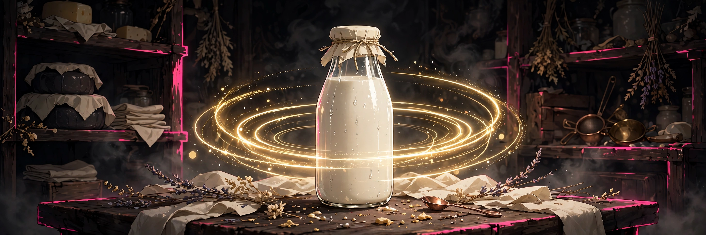

# Creamery

## 18+ — Adults Only

This game contains adult content. It is intended only for players 18 and older.

### Content notes

- Rhythm play timed to a pump cycle of strokes and a peak window
- Yield targets measured in millilitres and written into a book of record each cycle
- Comfort presets that trade a wider judge window for a slower yield, or a narrower window for a faster one

All characters depicted are adults.

## A rhythm game where you tap on each pump stroke and its peak to reach a target yield before the morning's time runs out.

<a href="https://github.com/NTRanch/creamery">GitHub</a> · <a href="https://github.com/NTRanch/creamery/blob/main/LICENSE.md">License</a> · <a href="https://ntranch.itch.io">itch.io studio page</a>

## Built with

 

## What you do

The pump runs in cycles: it draws in, counts its strokes, and opens a peak window at the top. Tap on each stroke beat and again on the peak. Hit strokes fill the cycle; a hit peak lets the whole cycle down at full rate. Every cycle is written into the book of record.

Reach the target yield before the morning's time runs out. The comfort presets change the trade: a wide judge window with a slower yield, or a narrow window with a faster yield — change the preset on the title screen, in Settings, or queue a new one mid-play and it applies at the next cycle, never mid-cycle. Settings and your best yield per level persist in the browser.

## Features

- Three levels: First Draw (4 strokes at 960 ms, target 150 ml), The Morning Round (5 strokes at 848 ms, target 240 ml), and The Full Book (6 strokes at 768 ms, target 400 ml)
- Two comfort presets — a wide judge window with slower yield against a narrow window with faster yield
- Sound-led sync: a 48 kHz sample clock drives the pump's animation phase, so what you see and what you hear cannot drift apart

## Media

- [Level 1 preview](../docs/previews/level-1-creamery.mp4)
- [Level 2 preview](../docs/previews/level-2-creamery.mp4)
- [Level 3 preview](../docs/previews/level-3-creamery.mp4)

## Controls

| Action | Keys |
|---|---|
| Tap on a stroke beat or the peak | Click or SPACE |
| Queue a new comfort preset mid-play | UP / DOWN |

## Status

**v1.0.0** — complete. Built for the Torogao Jam Program (a 14-week, one-game-per-week programme) for the Gameotron jam on itch.io. This GitHub page is the game's home while itch project slots are unavailable. Open `web/index.html` — one self-contained file that runs fully offline. Free to play.

## Credits

A Nice Thoughts Ranch game.

Made with Zig.
